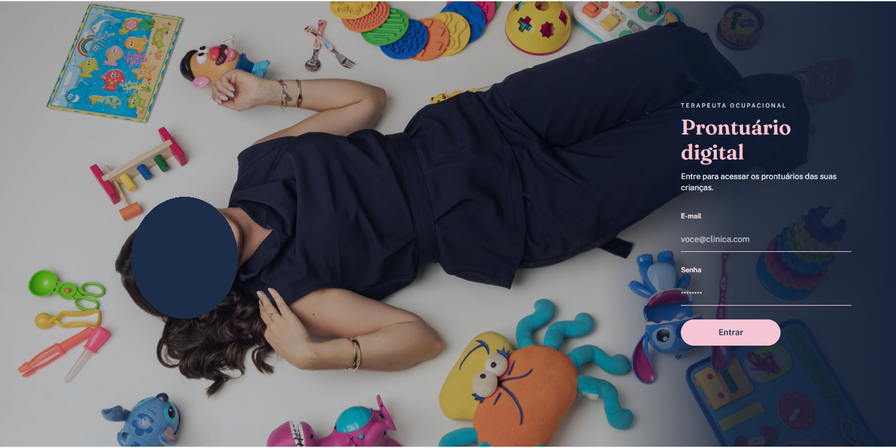
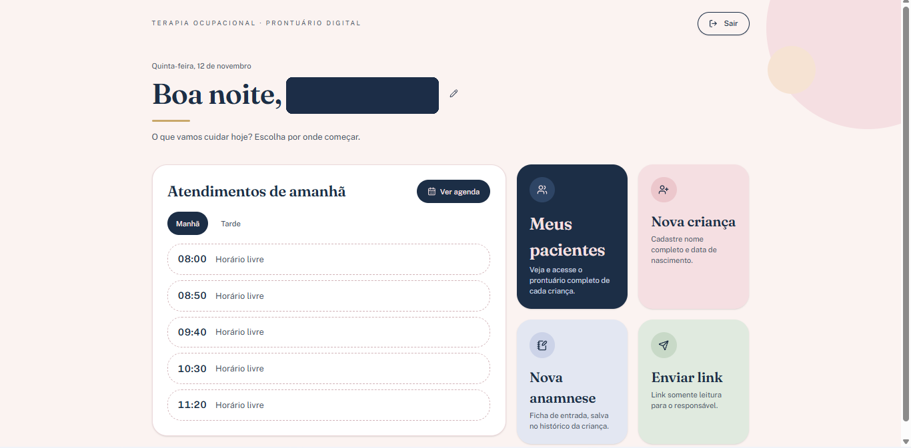
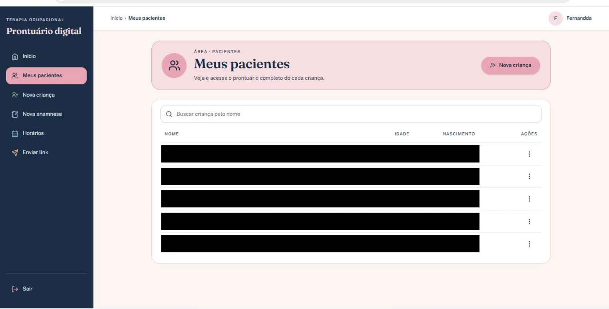
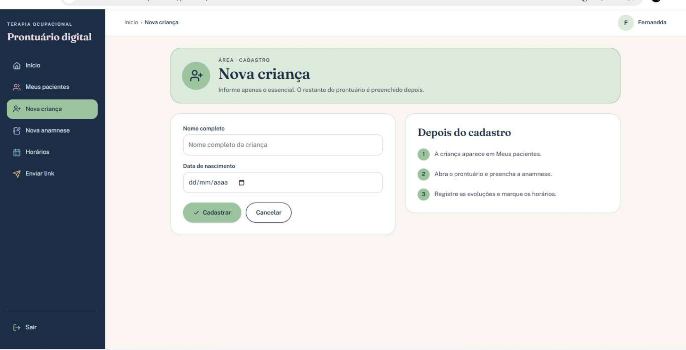
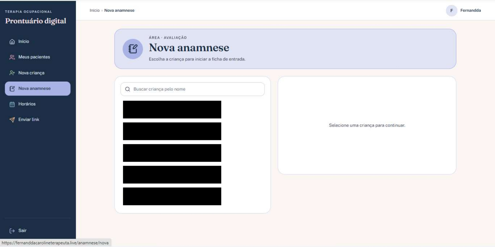
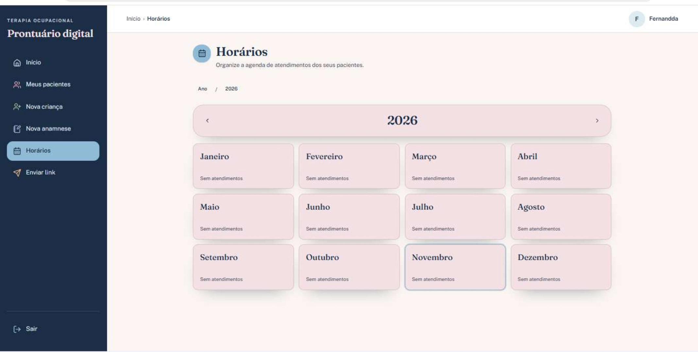
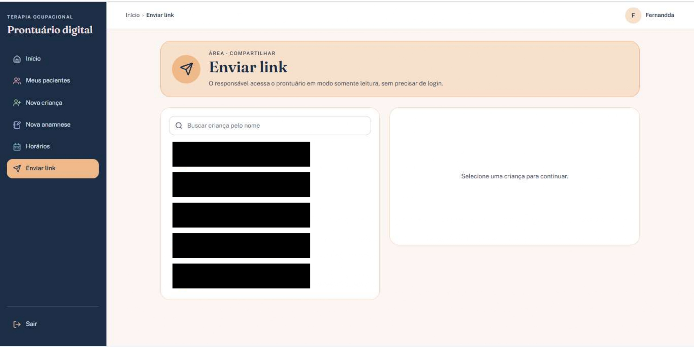

# Prontuário digital para terapia ocupacional

Sistema web criado para uma terapeuta ocupacional registrar atendimentos e relatórios e montar o quadro de horários do ano. As famílias acessam, por link, o histórico do paciente desde o início da terapia.

> Os prints abaixo usam dados cobertos ou fictícios. O sistema real não é público.

## O que eu fiz
- Defini as telas, as funções e o funcionamento do sistema.
- Estruturei o banco de dados no Supabase com apoio do Claude e criei o login de acesso.
- Apliquei as cores e a identidade visual da terapeuta.

## Tecnologias
Lovable e Supabase.

## Telas

### Tela de Login

### Tela Inicial

### Tela Meus Pacientes

### Tela Nova Criança

### Tela da Anamnese

### Tela de Horários

### Envio de link para o responsável

